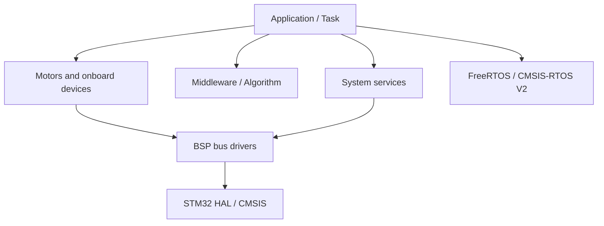

# CAT_BSP (`H7_BSP`)

[简体中文](README.md) · English

**A real-time STM32H7 embedded framework for RoboMaster and robot control.**

CAT_BSP (`H7_BSP` on GitHub) provides reusable board support, device drivers, control and estimation algorithms, and system health services. The reference board is the **Damiao DM-MC02 (STM32H723VGT6 / Cortex-M7 at 480 MHz)**. The framework uses **STM32 HAL and FreeRTOS (CMSIS-RTOS V2)**, builds with **GNU Arm, CMake, and Ninja**, and follows a **C with Classes** style.

> [!WARNING]
> Open [H7_BSP.ioc](H7_BSP.ioc) with **STM32CubeMX 6.15.0** and **STM32Cube FW_H7 V1.12.1**. If CubeMX displays a version prompt, select **Continue** to keep the existing firmware package. A migration can overwrite FreeRTOS V10.3.1 in `Middlewares/` and break compatibility with the SystemView trace macros and the patches in `User_Config/FreeRTOS_Patch/`.

## Highlights

- **STM32H7 memory and DMA** — A project-owned linker script and MPU configuration reserve `RAM_DMA` as a 64 KiB non-cacheable region. DMA1/DMA2 transmit and receive buffers live in `.dma_buffer`, which avoids D-cache coherency issues and placement in DTCM, which these controllers cannot access.
- **Low-jitter CAN** — Each of the three buses has an independent asynchronous command queue, avoiding head-of-line blocking across buses. Periodic transmit slots keep the latest payload. Multiple receive callbacks can share the same `(FDCAN, ID)` key, so several Damiao motors can share a `master_id`. `Can_Tx_Task` wakes on events and has a 1 ms fallback timeout.
- **Tiered NVIC priorities** — The control and timestamp timers, IMU SPI/DMA/EXTI, FDCAN, auxiliary timers, UART DMA, OSPI/MDMA, and USB run at distinct priority levels that match `H7_BSP.ioc`.
- **System health and live debugging** — `SYS_Health` reports initialization errors, IMU and flash health, supply voltage, and motors registered through `Sys_Health_Register_Motor()` (the built-in DJI, DM, and QD4310 drivers register automatically in `Init()`) at 20 Hz. `Sys_Health_Is_Safe()` lets the control loop select its safety branch. The WS2812 and buzzer indicate system health, and EmberProbe and GDB can read a consistent snapshot using the sequence counters.
- **C with Classes** — C++ builds disable exceptions and RTTI. Timing-critical control and driver paths use fixed-size data structures. FreeRTOS allocates tasks and message queues from `heap_5` during startup.

## Quick Start

### 1. Toolchain and Build

Install **CMake 3.22 or later**, **Ninja**, and the **GNU Arm Embedded toolchain**. Make sure `arm-none-eabi-gcc` and `arm-none-eabi-g++` are available on your `PATH`.

```bash
git clone https://github.com/MermaidFAR/H7_BSP.git CAT_BSP
cd CAT_BSP

# Debug build (-Og -g3) -> build/Debug/H7_BSP.elf
cmake --preset Debug
cmake --build --preset Debug --parallel

# Release build (-Os -g0) -> build/Release/H7_BSP.elf
cmake --preset Release
cmake --build --preset Release --parallel
```

[CMakePresets.json](CMakePresets.json) defines both build presets. The linker writes `H7_BSP.map` alongside the ELF file.

### 2. Flashing and Debugging

- **Flashing** — [User_Config/](User_Config) contains OpenOCD configurations and scripts for DAPLink and ST-Link probes.
- **Source debugging** — Load the Debug ELF in EmberProbe. Expand `SYS_Health` for system health and `BSP_BMI088` for attitude and sensor state.
- **Scheduling analysis** — Open [H7_BSP.SVPrj](H7_BSP.SVPrj) in SEGGER SystemView to inspect task preemption, interrupt timing, and stack high-water marks.
- **Telemetry** — `EricTool_USB` and `EricTool_UART` support JustFloat plotting and `variable:value#` commands for parameter tuning. See [Transport_Task.cpp](User_File/Task/Transport_Task.cpp) for an example.

### 3. Minimal Control Task Example

`TIM4` wakes [Control_Task.cpp](User_File/Task/Control_Task.cpp) at 1 kHz. The RTOS creates `ControlTask` at `osPriorityHigh1` as configured in `H7_BSP.ioc`. An application can use the health query, IMU attitude, and motor APIs in this task. Send the appropriate disable or zero-torque command for each actuator from the safety branch.

```cpp
extern "C" void Control_Task(void *argument)
{
    (void)argument;

    // Initialize application modules and motors here.

    for (;;)
    {
        osThreadFlagsWait(0x0001, osFlagsWaitAny, osWaitForever);

        if (!Sys_Health_Is_Safe())
        {
            // Send application-specific disable or zero-torque commands here.
            continue;
        }

        const Class_Matrix_f32<3, 1> euler = BSP_BMI088.Get_Euler_Angle();
        const float yaw_rad = euler[0][0];
        // Compute control outputs and update motor targets.
        // CAN_Tx_Perform() wakes Can_Tx_Task to send the latest payloads.
    }
}
```

## System Architecture

Download [Assets/Architecture/H7_BSP.html](Assets/Architecture/H7_BSP.html) and open it in a browser for an interactive dependency graph.



### Repository Layout

```text
User_File/
├── BSP/                    CAN, UART, SPI, USB, OSPI, and ADC drivers
├── Device/
│   ├── Onboard/            BMI088, W25Q64JV, power, WS2812, buzzer, and keys
│   └── Peripheral/         DJI, DM, and QD4310 motors and EricTool
├── Middleware/
│   └── Algorithm/          Control, trajectories, observers, filters, identification, and math
├── System/
│   ├── Callback/           Shared HAL weak callback dispatch for TIM, EXTI, SPI, and OSPI
│   ├── Critical/           Shared critical-section primitives in sys_critical.h
│   ├── Health/             20 Hz system health monitoring and safety queries in SYS_Health
│   ├── IMU/                VQF attitude and bias estimation settings
│   ├── Init/               Peripheral and device initialization and error flags
│   ├── Storage/            Partition layout for external W25Q64 flash
│   └── Timestamp/          1 MHz hardware timebase for microsecond timestamps
├── Task/                   CMSIS-RTOS V2 tasks for 1 kHz control, CAN TX, IMU, and health
└── Application/            SpinMode and PowerControl
Core/                       CubeMX-generated startup, peripheral, and FreeRTOS setup
Drivers/                    STM32H7 HAL and CMSIS drivers
Middlewares/                FreeRTOS, USB Device, and CMSIS-DSP
USB_DEVICE/                 USB CDC interface
User_Config/                Project linker script, FreeRTOS heap_5 patches, and probe settings
SystemView/                 SEGGER SystemView and RTT
cmake/                      GNU Arm and Clang toolchains and CubeMX build integration
```

### Modules

| Category | Components | Source and Documentation |
| :--- | :--- | :--- |
| **Board support** | Queued and periodic FDCAN transmit and receive dispatch, UART DMA with IDLE detection, double buffering, and error recovery, SPI DMA and synchronous transfers, USB CDC, OSPI, and ADC | [User_File/BSP](User_File/BSP) |
| **Motor drivers** | DJI M2006, M3508, and GM6020. Damiao MIT, position/velocity, velocity, and force/position modes. QDrive QD4310. | [DJI guide](User_File/Device/Peripheral/Motor/DJImotor/dji_motor.md) · [Damiao guide](User_File/Device/Peripheral/Motor/DMmotor/dm_motor.md) · [QD4310](User_File/Device/Peripheral/Motor/QDrive) |
| **Inertial sensing** | BMI088 FIFO and SPI DMA capture, supply-voltage compensation for the PWM heater, VQF attitude and bias estimation | [BMI088](User_File/Device/Onboard/BMI088) · [sys_imu](User_File/System/IMU) |
| **Onboard devices** | W25Q64JV external flash, 24 V and 5 V outputs and voltage sampling, WS2812, buzzer, and keys | [Onboard](User_File/Device/Onboard) |
| **Control and trajectories** | PID with derivative on measurement, D-term IIR filtering, and variable-rate integral separation. Sliding-mode control, disturbance observer, third-order S-curves, and Sugeno fuzzy inference. | [Algorithm](User_File/Middleware/Algorithm) |
| **LQR** | Fixed-size full-state feedback with runtime updates to gains computed offline, suited to balancing chassis and wheel-legged control | [LQR](User_File/Middleware/Algorithm/LQR/alg_lqr.h) |
| **CBF** | Closed-form first- and second-order scalar filters and a soft-constrained QP supporting up to four inputs and eight barrier constraints | [CBF](User_File/Middleware/Algorithm/CBF/alg_cbf.h) |
| **MPC** | Cached sparse Riccati recursion and bounded ADMM with input boxes, masked state boxes, and runtime bound updates. Supports up to six states, two inputs, and 25 steps | [MPC](User_File/Middleware/Algorithm/MPC/alg_mpc.h) |
| **ESO** | Standalone first- and second-order extended state observers that estimate total disturbance and provide compensation for velocity or position loops | [ESO](User_File/Middleware/Algorithm/ESO/alg_eso.h) |
| **ADRC** | Linear active disturbance rejection control that reuses the second-order ESO and can use a tracking differentiator for position or angle tracking under disturbances | [ADRC](User_File/Middleware/Algorithm/ADRC/alg_adrc.h) |
| **Estimation and filtering** | Kalman, EKF, VQF, recursive least squares, FIR/IIR, One Euro, and polynomial-fit differentiation | [Filter](User_File/Middleware/Algorithm/Filter) · [RLS](User_File/Middleware/Algorithm/RLS) |
| **Alpha-Beta** | Constant-velocity estimation of scalar position and velocity with fixed or variable sampling intervals and read-only prediction, suited to vision updates and brief frame gaps | [Alpha-Beta](User_File/Middleware/Algorithm/Filter/AlphaBeta/alg_filter_alpha_beta.h) |
| **Math and utilities** | Basic math, complex numbers, fixed-size matrices, quaternions, slew limiting, finite-state machines, queues, and pulse frequency division | [Algorithm](User_File/Middleware/Algorithm) |
| **Application control** | SpinMode for gimbal/chassis coordinate transforms and spin-speed feedforward. PowerControl for chassis power limiting and RLS identification. | [SpinMode](User_File/Application/SpinMode) · [PowerControl](User_File/Application/PowerControl) |
| **System and debugging** | Initialization, critical sections, callback dispatch, microsecond timestamps, system health snapshots, and EricTool over USB or UART | [System](User_File/System) · [EricTool](User_File/Device/Peripheral/EricTool) |

## Hardware and Real-Time Design

### 1. STM32H7 Memory and DMA Layout

[h7_memory.ld](User_Config/Linker/h7_memory.ld) and the MPU configuration define the memory layout. The FreeRTOS `heap_5` defaults to 64 KiB, with 48 KiB in DTCMRAM and 16 KiB in RAM_D1. Set `H7_FREERTOS_DTCM_HEAP_SIZE` to adjust the DTCMRAM share.

| Region | Start Address | Size | Use and Constraints |
| :--- | :--- | :--- | :--- |
| `DTCMRAM` | `0x20000000` | 128 KiB | General data, stacks, and part of the FreeRTOS heap. DMA1 and DMA2 cannot access it directly. |
| `RAM_DMA` | `0x24000000` | 64 KiB | `.dma_buffer` with 32-byte alignment. The MPU marks this region shareable and non-cacheable, so manual D-cache maintenance is unnecessary. |
| `RAM_D1` | `0x24010000` | 256 KiB | `.ram_d1_data` and part of the FreeRTOS heap. |
| `RAM_D2` / `RAM_D3` | `0x30000000` / `0x38000000` | 32 / 16 KiB | Other SRAM banks. Check which banks the DMA controller can reach before assigning buffers. |

### 2. NVIC Preemption Priorities

Lower numbers take precedence. Each interrupt below has subpriority `0`. See [H7_BSP.ioc](H7_BSP.ioc) for the configuration.

| Preemption Priority | Interrupts | Role |
| :--- | :--- | :--- |
| **5** | `TIM4`, `TIM5` | 1 kHz control task wakeup and 1 MHz hardware timestamp timebase |
| **6** | `SPI2`, `DMA1_Stream0/1`, `EXTI15_10` | BMI088 gyroscope and accelerometer interrupts and high-rate SPI DMA capture |
| **7** | `FDCAN1/2/3` (IT0 / IT1) | CAN transmit and receive for motors and peripherals |
| **8** | `TIM7`, `TIM8_UP_TIM13` | Auxiliary timing and peripheral control |
| **9** | `USART1/2/3/6/10`, `UART5/7`, remaining `DMA1/2` streams | UART DMA communication and telemetry |
| **10** | `OCTOSPI2`, `MDMA`, `DMA2_Stream5` | External flash and ADC sampling |
| **11** | `OTG_HS` | USB CDC communication |

### 3. System Health and Status Indicators

[Status_Task.cpp](User_File/Task/Status_Task.cpp) collects initialization errors, IMU and flash health, supply voltage, and motor probes registered via `Sys_Health_Register_Motor()` (built-in DJI, DM, and QD4310 drivers auto-register in `Init()`) at **20 Hz (50 ms)**. The default undervoltage threshold is `SYS_HEALTH_MIN_POWER_V = 18.0f`. For a consistent `SYS_Health` snapshot (`ABI_Version = 4`), check `ABI_Size` and confirm that `Sequence` and `Sequence_End` match and are even. `Sequence` must remain unchanged across the read.

| System State (`Overall_State`) | WS2812 LED | Buzzer | Typical Reasons (`Reason`) |
| :--- | :--- | :--- | :--- |
| `HEALTH_OK` | Solid green | Silent | All registered devices are online and supply voltage is normal. |
| `HEALTH_STARTING` / `HEALTH_UNINIT` | Blinking cyan | Silent | Waiting for the first frame during the 1 s startup window, or a peripheral has yet to initialize. |
| `HEALTH_WARN` | Blinking blue | Silent | Recoverable IMU issue such as SPI retries, outlier frames, or filter resets. |
| `HEALTH_OFFLINE` | Slow blinking yellow | Brief 800 Hz tone on entry | A motor or sensor has yet to send data (`NO_DATA`) or has timed out (`STALE`). |
| `HEALTH_FAULT` | Fast blinking red | 50 ms burst at 2400 Hz once per second | Hardware initialization failure (`INIT_FAILED`), undervoltage, a motor fault, or a timestamp anomaly. |

- **Mute for debugging** — Set `SYS_Health_Buzzer_Mute` to `1` in EmberProbe or GDB, or call `Sys_Health_Set_Buzzer_Mute(true)`. The LED and safety decision keep operating independently of the mute setting.
- **Telemetry channels** — Both `EricTool_USB` and `EricTool_UART` accept arrays of float pointers via `Set_Data(channels, count)`. For example, bind `&SYS_Health.Power_Voltage_V` as a channel. The default USB channels carry BMI088 yaw, pitch, and roll in radians, in that order. Their values refresh at most once every 5 ms.

### 4. FreeRTOS Task Responsibilities

FreeRTOS creates the application tasks with the priorities and stack sizes set in CubeMX under `FREERTOS.Tasks01`. See [H7_BSP.ioc](H7_BSP.ioc) and [freertos.c](Core/Src/freertos.c).

| Task | CMSIS Priority | Stack Size | Responsibility |
| :--- | :--- | ---: | :--- |
| [`BMI088Task`](User_File/Task/BMI088_Task.cpp) | `osPriorityHigh2` (42) | 8 KiB | Responds to SPI/FIFO events, processes gyro samples, runs VQF attitude estimation, and updates IMU health diagnostics and Euler telemetry |
| [`ControlTask`](User_File/Task/Control_Task.cpp) | `osPriorityHigh1` (41) | 8 KiB | Wakes from TIM4 at 1 kHz, checks system safety, and provides hooks for application control and actuator disable |
| [`CanTxTask`](User_File/Task/Can_Tx_Task.cpp) | `osPriorityHigh` (40) | 4 KiB | Handles asynchronous queues, periodic frames, and recovery on all three CAN buses, with event-driven wakeups and a 1 ms retry timeout |
| [`TransportTask`](User_File/Task/Transport_Task.cpp) | `osPriorityNormal` (24) | 8 KiB | Initializes USB CDC and sends IMU telemetry through EricTool |
| [`TIM_1ms_Task`](User_File/Task/TIM_1ms_Task.cpp) | `osPriorityLow` (8) | 4 KiB | Dispatches background callbacks for flash timeouts, keys, UART recovery, SPI service, ADC, LEDs, and BMI088 temperature reads and heater control every 128 ms |
| [`StatusTask`](User_File/Task/Status_Task.cpp) | `osPriorityLow` (8) | 2 KiB | Aggregates system health at 20 Hz and drives the status LED and buzzer |
| [`InsTask`](User_File/Task/Ins_Task.cpp) | `osPriorityLow` (8) | 1 KiB | Reserved inertial navigation extension that currently blocks while waiting for application events |
| [`StorageTask`](User_File/Task/Storage_Task.cpp) | `osPriorityLow` (8) | 4 KiB | Reserved storage extension that currently exits after startup |

## Development Conventions

- **C with Classes** — Use classes, member functions, and the existing fixed-size math templates. Avoid `auto`, lambdas, `std::initializer_list`, range-based `for` loops, `enum class`, `static_cast`, and `reinterpret_cast`. In new code, keep reserved double-underscore identifiers out, pass scalars by value, and use `fabsf()` and `sqrtf()` in single-precision paths.
- **Concurrency and critical sections** — Use `SYS_Enter_Critical()` and `SYS_Exit_Critical(primask)` from [sys_critical.h](User_File/System/Critical/sys_critical.h). Keep critical sections short and keep RTOS calls and lengthy protocol processing outside them.
- **Validation** — Validate inputs at public API entry points and check final actuator outputs. Avoid duplicate checks in private `static` functions and 1–2 kHz paths. Expose errors such as division by zero instead of silently returning the input.
- **Using CAN** — `CAN_Tx_Perform()` updates a periodic slot and wakes `Can_Tx_Task`. `CAN_Tx_Submit()` enqueues a message in the corresponding bus FIFO. Multiple callbacks can share a `(FDCAN, ID)` key. Override the default capacity of 32 with the `MAX_CAN_CALLBACKS` build macro.
- **Adding a module** — Add sources in the appropriate layer, bind resources in `Init()`, and register the source and include paths in the root [CMakeLists.txt](CMakeLists.txt). User code builds with `-Wextra -Wdouble-promotion -Wshadow`. Check the DMA section and NVIC priority when routing a new peripheral.

## Documentation and References

- Motor drivers — [DJI motor driver](User_File/Device/Peripheral/Motor/DJImotor/dji_motor.md) · [Damiao motor driver](User_File/Device/Peripheral/Motor/DMmotor/dm_motor.md)
- Release history — [CHANGELOG.md](CHANGELOG.md)
- ST application notes — AN4891 (STM32H7 system architecture and performance) and AN4839 (STM32F7/H7 level 1 cache)

## License and Acknowledgments

Original CAT_BSP code copyrighted by MermaidFAR is available under the [MIT License](LICENSE). The license permits use, modification, distribution, and commercial use when the copyright and license notices are preserved. STM32 HAL, CMSIS, FreeRTOS, SEGGER, and other third-party components retain their respective copyrights and licenses.

- Thanks to **Kylin-6** for contributing the Damiao motor driver, the initial usage guide, and the original DJI motor driver ([PR #4](https://github.com/MermaidFAR/H7_BSP/pull/4) and [PR #5](https://github.com/MermaidFAR/H7_BSP/pull/5)).
- Some drivers draw on the [Damiao MC02 BSP](https://github.com/yssickjgd/damiao_mc02_bsp). The UART implementation follows the organization of `drv_uart` from SCUT-Robotlab/Damiao. Thanks to the projects and their authors.
