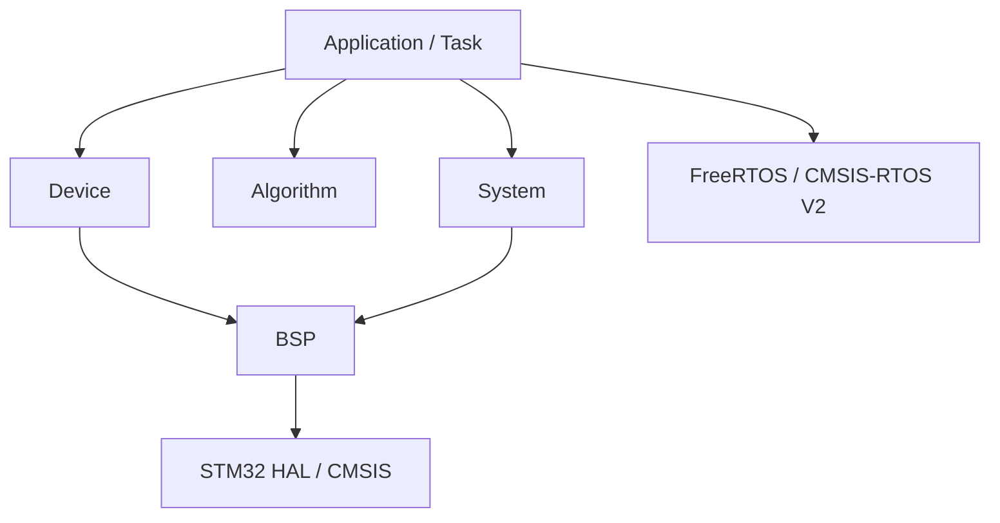

# CAT_BSP

**面向 RoboMaster 与机器人控制开发的 STM32H7 嵌入式框架。**

CAT_BSP 原名 H7_BSP，围绕板级支持、设备驱动、控制算法和系统服务提供可复用组件。
开发者可以按机器人需求组合通信、传感、执行和控制模块，在应用层组织自己的控制逻辑。
当前参考硬件为 **达妙 DM-MC02 / STM32H723VGT6**，工程采用 **STM32 HAL + FreeRTOS +
CMSIS-RTOS V2**，使用 **GNU Arm + CMake + Ninja** 构建。

[模块能力](#模块能力) · [快速开始](#快速开始) · [框架结构](#框架结构) · [扩展与移植](#扩展与移植) · [开发约定](#开发约定) · [文档入口](#文档入口) · [更新日志](CHANGELOG.md)

## 框架特点

- **分层组合**。BSP 管理外设资源，Device 封装设备协议，Algorithm 提供计算组件，
  System 提供公共服务，Application 与 Task 组织业务和调度。
- **面向机器人常用硬件**。集成 DJI、达妙和 QDrive 电机驱动，以及 BMI088、外部 Flash、
  电源、指示灯、蜂鸣器和调试通信组件。
- **独立的控制与估计算法**。提供 PID、滑模控制、扰动观测、S 曲线轨迹、状态估计和滤波等模块，
  通过输入、参数和周期计算接口组合使用。
- **可追踪的实时运行**。统一时间戳、初始化状态与健康快照，接入 SystemView、RTT 和遥测输出，
  便于观察任务周期、传感反馈和控制过程。
- **直接的工程组织**。用户模块采用 C 风格运算及简洁的结构体、函数与 `Class_` 封装，
  源码、头文件路径、链接布局和 RTOS 补丁在工程中显式维护。

## 模块能力

| 类别 | 已提供的组件 | 源码入口 |
| --- | --- | --- |
| 通信与外设 | CAN / FDCAN、UART DMA + IDLE、SPI、USB CDC、OSPI、ADC | [BSP](User_File/Middleware/BSP) |
| 电机驱动 | DJI M2006 / M3508 / GM6020、达妙电机、QDrive QD4310 | [Motor](User_File/Device/Peripheral/Motor) |
| 惯性传感 | BMI088 FIFO / SPI DMA 采集、温控、VQF 姿态与零偏估计 | [BMI088](User_File/Device/Onboard/BMI088)、[IMU](User_File/System/IMU) |
| 板载设备 | W25Q64JV Flash、电源控制与采样、WS2812、蜂鸣器、按键 | [Onboard](User_File/Device/Onboard) |
| 控制与轨迹 | PID、SMC、DOB、三阶 S 曲线、Sugeno 模糊推理 | [Algorithm](User_File/Middleware/Algorithm) |
| 估计与滤波 | Kalman、EKF、VQF、FIR / IIR、One Euro、多项式平滑与微分 | [Filter](User_File/Middleware/Algorithm/Filter) |
| 数学与辅助 | 基础运算、复数、定长矩阵、四元数、斜坡、状态机、队列、周期分频 | [Algorithm](User_File/Middleware/Algorithm) |
| 应用组件 | SpinMode 云台与底盘协调计算，支持跟随、锁定及小陀螺速度前馈 | [SpinMode](User_File/Application/SpinMode) |
| 系统与调试 | 初始化、HAL 回调分发、时间戳、健康状态、SystemView / RTT、EricTool | [System](User_File/System)、[EricTool](User_File/Device/Peripheral/EricTool) |

达妙电机的可用模式由型号与固件决定。设备 ID、方向、控制周期、反馈源和控制参数由具体应用配置。
当前 `Control_Task.cpp` 保留云台与平衡应用的接入位置，业务初始化和循环由使用方接入。

## 快速开始

### 硬件与软件基础

| 项目 | 当前工程配置 |
| --- | --- |
| 控制板 | 达妙 DM-MC02 |
| MCU | STM32H723VGT6，Cortex-M7，工程主频 480 MHz |
| 实时系统 | FreeRTOS V10.3.1，CMSIS-RTOS V2 接口 |
| 构建工具 | CMake ≥ 3.22、Ninja、GNU Arm Embedded 工具链 |
| CubeMX 工程 | STM32CubeMX 6.15.0，STM32Cube FW_H7 V1.12.1 |
| 调试方式 | OpenOCD / GDB、SEGGER Ozone、SystemView / RTT |

准备好工具链后，确认以下命令能在终端中执行。GNU Arm 工具链须包含 C/C++ 编译器及配套运行库。

```bash
arm-none-eabi-gcc --version
arm-none-eabi-g++ --version
cmake --version
ninja --version
```

### 获取与编译

当前仓库地址为 `MermaidFAR/H7_BSP`，克隆时可将本地目录命名为 `CAT_BSP`。
已有代码时直接进入现有仓库根目录，执行构建命令。

```bash
git clone https://github.com/MermaidFAR/H7_BSP.git CAT_BSP
cd CAT_BSP

cmake --preset Debug
cmake --build --preset Debug --parallel
```

Release 构建使用对应配置

```bash
cmake --preset Release
cmake --build --preset Release --parallel
```

| 配置 | 固件 | 链接映射 |
| --- | --- | --- |
| Debug | `build/Debug/H7_BSP.elf` | `build/Debug/H7_BSP.map` |
| Release | `build/Release/H7_BSP.elf` | `build/Release/H7_BSP.map` |

框架公开名称为 **CAT_BSP**。当前 CubeMX 工程入口为 `H7_BSP.ioc`，CMake 目标和固件基名为
`H7_BSP`，工程文件与产物路径按上表使用。构建配置见 [CMakePresets.json](CMakePresets.json)。

### 烧录与调试

选择适配 STM32H723 的探针与工具，将生成的 ELF 固件用于烧录或源码调试。
OpenOCD 的探针配置位于 `User_Config/`，Ozone 工程为 `H7_BSP.jdebug`，使用时按本机工具路径、
探针和固件位置调整。SystemView 工程为 `H7_BSP.SVPrj`。

- 使用 Ozone / GDB 观察电机反馈、算法状态、初始化结果与任务栈水位。
- 使用 SystemView / RTT 观察任务调度、中断和运行时信息。
- 使用 EricTool 通过 USB / UART 输出数据，`TransportTask` 提供周期输出示例。

## 框架结构



```text
User_File/
├── Application/            应用组件与控制逻辑
├── Task/                   CMSIS-RTOS V2 任务入口
├── Device/
│   ├── Onboard/            板载传感器、Flash、电源与指示组件
│   └── Peripheral/         电机及外接调试工具
├── Middleware/
│   ├── BSP/                外设管理、收发与回调注册
│   └── Algorithm/          控制、观测、滤波与数学组件
└── System/                 初始化、回调、时间戳、状态与调试
Core/                       CubeMX 生成的启动、外设和 RTOS 配置
Drivers/                    STM32 HAL / CMSIS
Middlewares/                FreeRTOS、USB Device、CMSIS-DSP
USB_DEVICE/                 USB CDC 配置
User_Config/                链接脚本、FreeRTOS 补丁与探针配置
SystemView/                 SystemView / RTT
cmake/                      工具链与 CubeMX 构建接入
```

启动时，`main.c` 完成 MPU、HAL 和外设初始化，调用 `System_Init()` 绑定资源并初始化设备，
随后初始化内核、创建任务并启动调度。运行期间，硬件事件经 HAL 回调和 BSP 分发到设备，
任务按各自周期组织采样、计算与发送。具体入口见 [main.c](Core/Src/main.c)、[Init.cpp](User_File/System/Init/Init.cpp) 和 [Task](User_File/Task)。

## 扩展与移植

### 添加设备或协议

- 在 `Device/Onboard/` 或 `Device/Peripheral/` 中添加设备头文件与实现，参照同层模块组织配置、状态和接口。
- 复用 BSP 外设管理对象及回调注册，设备层负责协议编解码，应用层负责业务目标。
- 在显式 `Init()` 中绑定外设资源，按依赖顺序接入系统初始化，RTOS 对象在内核初始化后建立。
- 在任务或周期回调中接入计算与发送，明确中断上下文、缓冲区所有权和数据有效期。
- 在根 `CMakeLists.txt` 注册源码与头文件路径，完成构建并核对设备的实际收发行为。

### 组合控制与算法

在应用层提供目标与反馈，按模块约定初始化状态、量纲和采样周期，再调用周期计算接口。
例如，电机控制可以组合 PID 与轨迹规划，姿态处理可以组合 BMI088 与 VQF，
云台和底盘协调可复用 SpinMode 的坐标变换与角速度前馈。
各组件的输入、状态和参数定义见对应头文件。

### 适配其他硬件

以当前 MC02 配置为参考，调整 CubeMX 外设、引脚、时钟、DMA 和中断设置，
同步修改 BSP 管理入口、设备资源绑定、链接脚本及 MPU 配置，再接入上层控制与调度。

## 开发约定

### 总线与回调

- CAN 周期目标通过 `CAN_Tx_Perform()` 更新，同一总线与 ID 保留最新数据。
  使能、复位和模式设置等顺序命令通过 `CAN_Tx_Submit()` 入队。
  `CanTxTask` 负责处理两条发送通道。
- CAN 接收回调运行于中断上下文，应用按此上下文安排解析和数据交接。
  软件提交结果、硬件发送状态和设备执行反馈分别由对应接口与协议处理。
- UART 使用 DMA + IDLE 接收。带 TX DMA 的端口将发送数据复制到专用缓冲，调用后原始数据可复用。
  UART 或 DMA 忙时返回 `HAL_BUSY`，应用据返回状态安排后续发送。

### DMA 与内存布局

工程通过 `User_Config/Linker/h7_memory.ld` 和 MPU 配置管理内存。

| 区域 | 地址 | 大小 | 用途 |
| --- | --- | --- | --- |
| `DTCMRAM` | `0x20000000` | 128 KiB | 普通数据、栈和部分 FreeRTOS heap |
| `RAM_DMA` | `0x24000000` | 64 KiB | `.dma_buffer`，共享且不可缓存 |
| `RAM_D1` | `0x24010000` | 256 KiB | `.ram_d1_data` 和部分 FreeRTOS heap |
| `RAM_D2` / `RAM_D3` | `0x30000000` / `0x38000000` | 32 / 16 KiB | 按具体外设和 DMA 控制器配置使用 |

DMA1 / DMA2 的共享缓冲放入 `.dma_buffer`，同时核对对齐、生命周期与传输长度。
DTCMRAM 的可达性限于 CPU 和 MDMA。调整 DMA、内存区域或缓存属性时，同步核对链接脚本与 MPU。
FreeRTOS 使用 `heap_5`，默认总量 64 KiB，分配为 48 KiB DTCMRAM 与 16 KiB RAM_D1，
DTCM 分区由 `H7_FREERTOS_DTCM_HEAP_SIZE` 配置。

### 初始化与代码组织

`System_Get_Init_Errors()` 返回 BMI088、Flash 和 ADC1 的初始化错误位，`init_finished` 记录初始化流程结束。
设备接入时结合错误位与设备状态安排后续使用。

用户模块沿用 `Struct_`、`Enum_`、`Class_` 命名及同层文件组织，内部优先采用直接的 C 风格运算。
硬件访问集中在 `Init()`，C 调用入口通过 `extern "C"` 暴露，任务与同步使用 CMSIS-RTOS V2。

### CubeMX 工程维护

使用 **STM32CubeMX 6.15.0 + STM32Cube FW_H7 V1.12.1** 打开 `H7_BSP.ioc`。
遇到版本提示时选择 **Continue**，保留当前固件包配置。

`Migrate` 会更新工程的数据库与固件版本，重新生成可能替换 FreeRTOS，影响 SystemView 跟踪宏和
`User_Config/FreeRTOS_Patch/` 中的适配。固件升级需要配套验证 RTOS、跟踪组件与补丁。
CubeMX 用户修改放在 `USER CODE BEGIN/END` 区域，用户源码注册、链接脚本和补丁维护在工程配置中。
重新生成后执行 configure / build 并核对这些集成入口。

## 文档入口

- 电机反馈、配置与控制接口见 [DJI 电机驱动](User_File/Device/Peripheral/Motor/DJImotor/dji_motor.md) 和 [达妙电机驱动](User_File/Device/Peripheral/Motor/DMmotor/dmmotor.md)。
- 框架现有模块的详细关系见 [模块全景图](Assets/Architecture/H7_BSP.svg) 和 [交互图](Assets/Architecture/H7_BSP.html)。
- 版本变更见 [CHANGELOG](CHANGELOG.md)。

## 反馈与贡献

反馈问题时附上代码版本、控制板、工具链版本、复现步骤及相关日志。
新增驱动或算法沿用对应层的接口和文件组织，并说明参数单位、计算周期和验证结果。

## 许可与致谢

项目级许可证待确定。仓库内 STM32 HAL、CMSIS、FreeRTOS、SEGGER 及其他第三方组件，
按各自源码目录中的版权声明和许可使用。

感谢 Kylin-6 贡献达妙电机驱动、初版使用说明和 DJI 电机原始驱动。
贡献记录见 [达妙驱动 PR #4](https://github.com/MermaidFAR/H7_BSP/pull/4) 和 [DJI 驱动 PR #5](https://github.com/MermaidFAR/H7_BSP/pull/5)。

部分驱动参考达妙 MC02 BSP，UART 实现参考 SCUT-Robotlab / 达妙 `drv_uart` 的组织方式。
感谢相关开源项目与原作者，来源见 [达妙 MC02 BSP](https://github.com/yssickjgd/damiao_mc02_bsp)。
