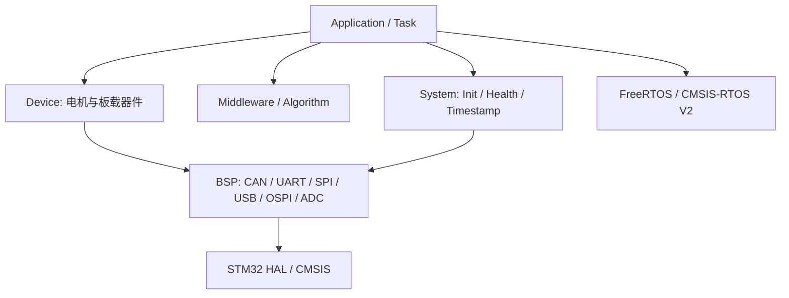

# CAT_BSP (`H7_BSP`)

简体中文 · [English](README.en.md)

**面向 RoboMaster 与机器人控制的 STM32H7 实时嵌入式框架。**

CAT_BSP（仓库名 `H7_BSP`）围绕板级外设、设备驱动、控制/估计算法与系统安全服务提供可复用的工程底座。参考硬件为 **达妙 DM-MC02（STM32H723VGT6 / Cortex-M7 @ 480 MHz）**，基于 **STM32 HAL + FreeRTOS (CMSIS-RTOS V2)**，使用 **GNU Arm + CMake + Ninja** 构建，代码统一遵循 **C with Classes** 风格。

> [!WARNING]
> **CubeMX 维护须知**：请使用 **STM32CubeMX 6.15.0 + STM32Cube FW_H7 V1.12.1** 打开 [H7_BSP.ioc](H7_BSP.ioc)，遇到版本提示时务必选择 **Continue**，**严禁选择 Migrate**。升级固件包可能覆盖 `Middlewares/` 中的 FreeRTOS（V10.3.1），导致 SystemView 跟踪宏与 `User_Config/FreeRTOS_Patch/` 补丁不兼容。

## 核心亮点

- **STM32H7 内存域与 DMA 治理**：通过自有链接脚本与 MPU 配置划分 `RAM_DMA`（64 KiB 不可缓存区），DMA1/DMA2 收发缓冲统一放入 `.dma_buffer`，规避 D-Cache 一致性与 DTCM 不可达陷阱。
- **低抖动 CAN 底座**：三总线独立异步命令队列（消除跨总线队头阻塞）、周期最新值覆盖槽、同一 `(FDCAN, ID)` 一对多回调分发（原生兼容多台达妙电机共享 `master_id`），以及事件驱动 + 1 ms 超时兜底的 `Can_Tx_Task`。
- **NVIC 抢占优先级分层**：基准定时、IMU SPI/DMA/EXTI、FDCAN、辅助定时、UART DMA、OSPI/MDMA 与 USB 分层配置，并与 `H7_BSP.ioc` 同步。
- **整车健康联动与实时观测**：20 Hz `SYS_Health` 汇总初始化错误、IMU、Flash、电源电压与 DJI / DM / QD4310 三类电机。控制层通过 `Sys_Health_Is_Safe()` 判定是否进入安全分支，WS2812 与蜂鸣器显示健康状态，EmberProbe / GDB 可通过 Seqlock 读取一致的快照。
- **C with Classes 风格**：C++ 构建关闭异常与 RTTI，控制和驱动热路径使用定长数据结构。启动时 FreeRTOS 从 `heap_5` 分配任务与消息队列。

## 快速开始

### 1. 工具链与构建

准备 **CMake ≥ 3.22**、**Ninja** 与 **GNU Arm Embedded 工具链**（确保 `arm-none-eabi-gcc` / `arm-none-eabi-g++` 可用）：

```bash
git clone https://github.com/MermaidFAR/H7_BSP.git CAT_BSP
cd CAT_BSP

# Debug 构建 (-Og -g3) -> build/Debug/H7_BSP.elf
cmake --preset Debug
cmake --build --preset Debug --parallel

# Release 构建 (-Os -g0) -> build/Release/H7_BSP.elf
cmake --preset Release
cmake --build --preset Release --parallel
```

构建配置见 [CMakePresets.json](CMakePresets.json)，链接映射输出为同目录下的 `H7_BSP.map`。

### 2. 烧录与调试

- **烧录与探针**：OpenOCD 探针配置及脚本位于 [User\_Config/](User_Config)，支持 DAPLink / ST-Link。
- **源码调试**：在 EmberProbe 中加载 Debug 构建的 ELF，展开 `SYS_Health` 查看整车健康状态，展开 `BSP_BMI088` 查看姿态与传感器状态。
- **调度分析**：使用 SEGGER SystemView 打开 [H7_BSP.SVPrj](H7_BSP.SVPrj) 查看任务抢占、中断耗时与栈水位。
- **曲线遥测**：`EricTool_USB` / `EricTool_UART` 支持 JustFloat 绘图与 `variable:value#` 调参指令，示例见 [Transport\_Task.cpp](User_File/Task/Transport_Task.cpp)。

### 3. 最小接入示例

[Control_Task.cpp](User_File/Task/Control_Task.cpp) 由 `TIM4` 以 1 kHz 节拍唤醒，RTOS 按 `H7_BSP.ioc` 配置以 `osPriorityHigh1` 创建 `ControlTask`。应用可组合健康判定、IMU 姿态和电机接口，并在安全分支接入设备适用的失能或零力矩指令。

```cpp
extern "C" void Control_Task(void *argument)
{
    (void)argument;

    // 在此处完成业务模块与电机 Init()

    for (;;)
    {
        osThreadFlagsWait(0x0001, osFlagsWaitAny, osWaitForever);

        if (!Sys_Health_Is_Safe())
        {
            // 在此发送应用专用的失能或零力矩指令。
            continue;
        }

        const Class_Matrix_f32<3, 1> euler = BSP_BMI088.Get_Euler_Angle();
        const float yaw_rad = euler[0][0];
        // 计算控制量并更新电机目标 -> CAN_Tx_Perform() 自动唤醒 Can_Tx_Task 发送
    }
}
```

## 系统架构

> 可下载 [Assets/Architecture/H7\_BSP.html](Assets/Architecture/H7_BSP.html) 在本地浏览器中查看交互式依赖图。



### 工程目录

```text
User_File/
├── BSP/                    外设总线驱动（CAN、UART、SPI、USB、OSPI、ADC）
├── Device/
│   ├── Onboard/            板载器件（BMI088、W25Q64JV、Power、WS2812、Buzzer、Key）
│   └── Peripheral/         外接器件（DJI / DM / QD4310 电机、EricTool 调试工具）
├── Middleware/
│   └── Algorithm/          控制、轨迹、观测、滤波、辨识与数学库
├── System/
│   ├── Callback/           HAL 弱回调统一路由（TIM / EXTI / SPI / OSPI）
│   ├── Critical/           统一临界区原语（sys_critical.h）
│   ├── Health/             20 Hz 整车健康监控与安全判定（SYS_Health）
│   ├── IMU/                VQF 姿态与零偏估计参数配置
│   ├── Init/               外设与器件统一初始化及错误掩码
│   ├── Storage/            W25Q64 外部 Flash 分区布局定义
│   └── Timestamp/          1 MHz 硬件微秒时间戳基准
├── Task/                   CMSIS-RTOS V2 任务入口（1 kHz 控制、CAN 发送、IMU 解算、健康等）
└── Application/            应用级控制策略（SpinMode、PowerControl、Communication）
Core/                       CubeMX 生成的启动、外设与 FreeRTOS 配置
Drivers/                    STM32H7 HAL / CMSIS 驱动
Middlewares/                FreeRTOS、USB Device、CMSIS-DSP
USB_DEVICE/                 USB CDC 接口实现
User_Config/                自有链接脚本、FreeRTOS heap_5 补丁与探针烧录配置
SystemView/                 SEGGER SystemView 与 RTT
cmake/                      GNU Arm / Clang 工具链与 CubeMX 构建接入
```

### 模块能力总览

| 类别 | 已提供组件 | 源码与文档入口 |
| :--- | :--- | :--- |
| **外设总线 (BSP)** | FDCAN 队列发送、周期发送与接收分发、UART DMA+IDLE 双缓冲与错误恢复、SPI DMA/同步、USB CDC、OSPI、ADC | [User\_File/BSP](User_File/BSP) |
| **电机驱动** | DJI（M2006 / M3508 / GM6020）、达妙（MIT / 位置速度 / 速度 / 力位）、QDrive QD4310 | [DJI 文档](User_File/Device/Peripheral/Motor/DJImotor/dji_motor.md) · [达妙文档](User_File/Device/Peripheral/Motor/DMmotor/dm_motor.md) · [QD4310](User_File/Device/Peripheral/Motor/QDrive) |
| **惯性传感** | BMI088 FIFO / SPI DMA 采集、恒温加热 PWM 电压补偿、VQF 姿态与零偏估计 | [BMI088](User_File/Device/Onboard/BMI088) · [sys\_imu](User_File/System/IMU) |
| **板载器件** | W25Q64JV 外部 Flash、24 V/5 V 电源输出与电压采样、WS2812、蜂鸣器、按键 | [Onboard](User_File/Device/Onboard) |
| **控制与轨迹** | PID（微分先行 / D 支路 IIR / 变速分离积分）、SMC 滑模、DOB 扰动观测、三阶 S 曲线、Sugeno 模糊推理 | [Algorithm](User_File/Middleware/Algorithm) |
| **LQR** | 定长全状态反馈，支持在线更新离线求得的增益，适合平衡底盘和轮腿控制 | [LQR](User_File/Middleware/Algorithm/LQR/alg_lqr.h) |
| **CBF** | 一阶和二阶标量解析限位，以及最多 4 路输入、8 条软约束的安全滤波 QP | [CBF](User_File/Middleware/Algorithm/CBF/alg_cbf.h) |
| **MPC** | 稀疏 Riccati 预分解与有界 ADMM，支持输入盒、按分量启用的状态盒及在线限幅更新，最大 6 状态、2 输入、25 步 | [MPC](User_File/Middleware/Algorithm/MPC/alg_mpc.h) |
| **ESO** | 独立的一阶和二阶扩张状态观测器，可为速度环或位置环估计总扰动并提供补偿量 | [ESO](User_File/Middleware/Algorithm/ESO/alg_eso.h) |
| **ADRC** | 复用二阶 ESO 的线性自抗扰控制，支持搭配跟踪微分器，用于受外扰的位置或角度跟踪 | [ADRC](User_File/Middleware/Algorithm/ADRC/alg_adrc.h) |
| **估计与滤波** | Kalman、EKF、VQF、RLS 递推最小二乘、FIR / IIR、One Euro、多项式拟合微分 | [Filter](User_File/Middleware/Algorithm/Filter) · [RLS](User_File/Middleware/Algorithm/RLS) |
| **Alpha-Beta** | 以常速度模型估计标量位置与速度，支持固定周期、变步长和只读外推，适合视觉位置更新与短时丢帧 | [Alpha-Beta](User_File/Middleware/Algorithm/Filter/AlphaBeta/alg_filter_alpha_beta.h) |
| **数学与辅助** | Basic、Complex、定长 Matrix、Quaternion、Slope、FSM、Queue、Pulse 周期分频 | [Algorithm](User_File/Middleware/Algorithm) |
| **应用策略** | SpinMode（云台/底盘坐标变换与小陀螺速度前馈）、PowerControl（底盘功率限制与 RLS 辨识） | [SpinMode](User_File/Application/SpinMode) · [PowerControl](User_File/Application/PowerControl) |
| **系统与调试** | 统一初始化、临界区、回调分发、微秒时间戳、整车健康快照、EricTool（USB/UART） | [System](User_File/System) · [EricTool](User_File/Device/Peripheral/EricTool) |

## 硬件与实时性设计

### 1. STM32H7 内存与 DMA 布局

工程通过 [h7\_memory.ld](User_Config/Linker/h7_memory.ld) 与 MPU 配置管理内存，FreeRTOS 采用 `heap_5`（默认总量 64 KiB = 48 KiB DTCMRAM + 16 KiB RAM_D1，DTCMRAM 份额可通过 `H7_FREERTOS_DTCM_HEAP_SIZE` 调整）：

| 内存区域 | 起始地址 | 大小 | 用途与约束 |
| :--- | :--- | :--- | :--- |
| `DTCMRAM` | `0x20000000` | 128 KiB | 普通数据、栈、部分 FreeRTOS heap；DMA1/DMA2 不可直接访问 |
| `RAM_DMA` | `0x24000000` | 64 KiB | `.dma_buffer`（32 字节对齐）；MPU 配为共享、不可缓存，无需手工 D-Cache 维护 |
| `RAM_D1` | `0x24010000` | 256 KiB | `.ram_d1_data` 与部分 FreeRTOS heap |
| `RAM_D2` / `RAM_D3` | `0x30000000` / `0x38000000` | 32 / 16 KiB | 其余 SRAM，使用时需核对对应 DMA 控制器可达性 |

### 2. NVIC 抢占优先级分层

下表列出主要应用外设的抢占优先级。数值越小优先级越高，各项子优先级为 `0`，配置见 [H7_BSP.ioc](H7_BSP.ioc)。

| 抢占优先级 | 中断源 | 职责 |
| :--- | :--- | :--- |
| **5** | `TIM4`、`TIM5` | 1 kHz 控制节拍唤醒、1 MHz 硬件微秒时间戳基准 |
| **6** | `SPI2`、`DMA1_Stream0/1`、`EXTI15_10` | BMI088 陀螺仪/加速度计中断与高频 SPI DMA 采集 |
| **7** | `FDCAN1/2/3`（IT0 / IT1） | 电机与外设 CAN 实时收发 |
| **8** | `TIM7`、`TIM8_UP_TIM13` | 辅助定时与外设控制 |
| **9** | `USART1/2/3/6/10`、`UART5/7`、其余 `DMA1/2` | 串口 DMA 通信与遥测 |
| **10** | `OCTOSPI2`、`MDMA`、`DMA2_Stream5` | 外部 Flash 与 ADC 采样 |
| **11** | `OTG_HS` | USB CDC 通信 |

### 3. 整车健康监控与声光联动

[Status\_Task.cpp](User_File/Task/Status_Task.cpp) 以 **20 Hz（50 ms）** 汇总初始化错误、IMU、Flash、电源电压（默认欠压阈值 `SYS_HEALTH_MIN_POWER_V = 18.0f`）及三类已注册电机，写入全局快照 `SYS_Health`（`ABI_Version = 3`）。读取时核对 `ABI_Size`，并确认 `Sequence` 与 `Sequence_End` 相等且为偶数。读取期间 `Sequence` 应保持不变。

| 整车状态 (`Overall_State`) | WS2812 指示灯 | 蜂鸣器提示 | 常见原因 (`Reason`) |
| :--- | :--- | :--- | :--- |
| `HEALTH_OK` | 绿灯常亮 | 静音 | 全部已注册设备在线且电源正常 |
| `HEALTH_STARTING` / `HEALTH_UNINIT` | 青灯闪烁 | 静音 | 启动等待首帧（1 s 窗口）或外设未初始化 |
| `HEALTH_WARN` | 蓝灯闪烁 | 静音 | IMU 存在可恢复异常（SPI 重试 / 离群帧 / 滤波复位） |
| `HEALTH_OFFLINE` | 黄灯慢闪 | 切入时 800 Hz 短鸣 | 电机或传感器从未连上（`NO_DATA`）或中途超时（`STALE`） |
| `HEALTH_FAULT` | 红灯快闪 | 每秒 2400 Hz 短鸣 50 ms | 硬件初始化失败（`INIT_FAILED`）、欠压、电机故障或时间戳异常 |

- **调试静音**：在 EmberProbe / GDB 中将 `SYS_Health_Buzzer_Mute` 置 `1`（或调用 `Sys_Health_Set_Buzzer_Mute(true)`）即可静音，不影响灯效与 `Sys_Health_Is_Safe()` 安全判定。
- **遥测绑定**：`EricTool_USB` 与 `EricTool_UART` 均支持 `Set_Data(channels, count)` 浮点指针数组接口，可直接绑定 `&SYS_Health.Power_Voltage_V`。USB 默认按 yaw、pitch、roll 顺序发送 BMI088 欧拉角，单位为 rad，数据每 5 ms 至多刷新一次。

### 4. FreeRTOS 任务分工

应用任务的创建优先级和栈大小来自 CubeMX 的 `FREERTOS.Tasks01` 配置。配置与创建代码见 [H7_BSP.ioc](H7_BSP.ioc) 和 [freertos.c](Core/Src/freertos.c)。

| 任务 | CMSIS 优先级 | 栈大小 | 职责 |
| :--- | :--- | ---: | :--- |
| [`BMI088Task`](User_File/Task/BMI088_Task.cpp) | `osPriorityHigh2`（42） | 8 KiB | 响应 SPI/FIFO 事件，处理陀螺仪样本、执行 VQF 姿态解算，更新 IMU 健康诊断与欧拉角遥测 |
| [`ControlTask`](User_File/Task/Control_Task.cpp) | `osPriorityHigh1`（41） | 8 KiB | 由 TIM4 以 1 kHz 唤醒，检查整车安全状态并提供正常控制与失能的应用扩展口 |
| [`CanTxTask`](User_File/Task/Can_Tx_Task.cpp) | `osPriorityHigh`（40） | 4 KiB | 处理三路 CAN 的异步队列、周期帧与总线恢复，事件唤醒并以 1 ms 超时重试 |
| [`TransportTask`](User_File/Task/Transport_Task.cpp) | `osPriorityNormal`（24） | 8 KiB | 初始化 USB CDC，发送 EricTool 的 IMU 遥测 |
| [`TIM_1ms_Task`](User_File/Task/TIM_1ms_Task.cpp) | `osPriorityLow`（8） | 4 KiB | 分发后台周期回调，包括 Flash 超时、按键、UART 恢复、SPI 服务、ADC、灯效及每 128 ms 的 BMI088 温度读取与温控 |
| [`StatusTask`](User_File/Task/Status_Task.cpp) | `osPriorityLow`（8） | 2 KiB | 以 20 Hz 汇总整车健康并驱动状态灯与蜂鸣器 |
| [`InsTask`](User_File/Task/Ins_Task.cpp) | `osPriorityLow`（8） | 1 KiB | 预留惯性导航扩展口，当前阻塞等待应用事件 |
| [`StorageTask`](User_File/Task/Storage_Task.cpp) | `osPriorityLow`（8） | 4 KiB | 预留存储扩展口，当前在启动后退出 |

## 开发约定

- **C with Classes 风格**：允许使用 `class`、成员函数与已有定长数学模板；**禁用** `auto`、`lambda`、`std::initializer_list`、范围 `for`、`enum class`、`static_cast` / `reinterpret_cast`。新代码不引入以 `__` 开头的保留标识符，标量按值传递，单精度路径使用 `fabsf()` / `sqrtf()`。
- **并发与临界区**：统一调用 [sys\_critical.h](User_File/System/Critical/sys_critical.h) 的 `SYS_Enter_Critical()` / `SYS_Exit_Critical(primask)`，临界区应保持简短，**严禁调用 RTOS API 或执行耗时协议处理**。
- **防御边界（外严内松）**：公开 API 入口与执行器最终输出严格校验；内部 `static` 函数与 1~2 kHz 热路径避免重复校验；禁止除零静默返回原值等掩盖错误的写法。
- **CAN 使用说明**：`CAN_Tx_Perform()` 更新周期槽并唤醒 `Can_Tx_Task`，`CAN_Tx_Submit()` 进入对应总线独立 FIFO 队列；同一 `(FDCAN, ID)` 支持多回调注册，默认容量 `MAX_CAN_CALLBACKS = 32` 可通过编译宏覆盖。
- **新增模块流程**：在对应层目录添加源码 → 在 `Init()` 中绑定资源 → 在根 [CMakeLists.txt](CMakeLists.txt) 注册源码与头文件路径（用户代码已启用 `-Wextra -Wdouble-promotion -Wshadow`）→ 核对 DMA 内存段与 NVIC 优先级。

## 文档与参考

- 电机驱动说明：[DJI 电机驱动](User_File/Device/Peripheral/Motor/DJImotor/dji_motor.md) · [达妙电机驱动](User_File/Device/Peripheral/Motor/DMmotor/dm_motor.md)
- 版本变更记录：[CHANGELOG.md](CHANGELOG.md)
- 官方硬件参考：ST AN4891（STM32H7 系统架构与性能）、ST AN4839（STM32F7/H7 一级缓存）

## 许可与致谢

CAT_BSP 中由 MermaidFAR 持有版权的原创代码采用 [MIT 许可证](LICENSE)，允许在保留版权和许可声明的前提下使用、修改、分发及用于商业项目。STM32 HAL、CMSIS、FreeRTOS、SEGGER 及其他第三方组件保留各自原有版权与许可条款。

- 感谢 **Kylin-6** 贡献达妙电机驱动、初版使用说明和 DJI 电机原始驱动（[PR #4](https://github.com/MermaidFAR/H7_BSP/pull/4)、[PR #5](https://github.com/MermaidFAR/H7_BSP/pull/5)）。
- 部分驱动参考 [达妙 MC02 BSP](https://github.com/yssickjgd/damiao_mc02_bsp)，UART 实现参考 SCUT-Robotlab / 达妙 `drv_uart` 的组织方式，感谢相关开源项目与原作者。
